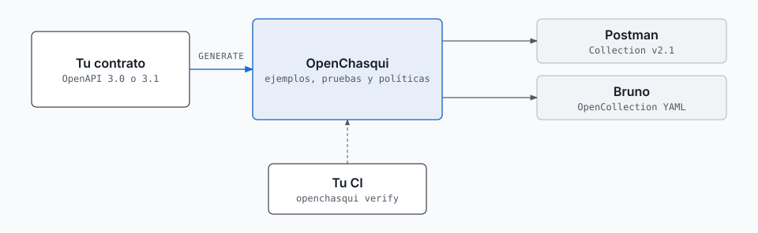
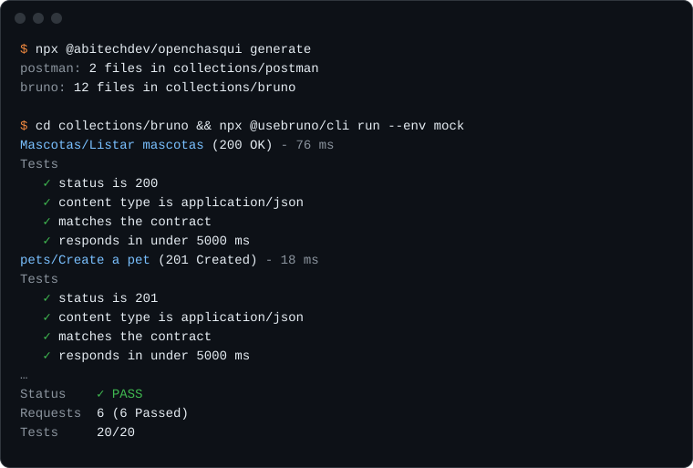

<p align="center">
  <picture>
    <source media="(prefers-color-scheme: dark)" srcset="docs/imagenes/logo-oscuro.svg">
    
  </picture>
</p>

<h1 align="center">OpenChasqui</h1>

<p align="center">Generates, validates and ships API collections, such as Postman and Bruno, from an OpenAPI contract</p>

<p align="center">
  <a href="https://www.npmjs.com/package/@abitechdev/openchasqui"></a>
  <a href="https://github.com/abitech-dev/abitech-openchasqui-cli/actions/workflows/ci.yml"></a>
  
  <a href="LICENSE"></a>
</p>

<p align="center">
  <a href="#quick-start">Quick start</a> &nbsp;|&nbsp;
  <a href="#usage">Usage</a> &nbsp;|&nbsp;
  <a href="#documentation">Documentation</a> &nbsp;|&nbsp;
  <a href="README.md">Español</a>
</p>

<picture>
  <source media="(prefers-color-scheme: dark)" srcset="docs/diagramas/flujo-dark.svg">
  
</picture>

The _chasqui_ carried messages along the Inca road network. OpenChasqui carries
your API contract to every tool your team uses, with environments, realistic
examples and contract tests, and continuous integration keeps them current.

> [!NOTE]
> OpenChasqui is in early development (0.x). The configuration and the plugin
> contract may change before 1.0.

## What it does

<table>
  <tr>
    <td width="50%" valign="top">
      <picture><source media="(prefers-color-scheme: dark)" srcset="docs/iconos/fuente-dark.svg"></picture><br><strong>A single source of truth</strong><br>Collections come from the contract and are never edited by hand.
    </td>
    <td width="50%" valign="top">
      <picture><source media="(prefers-color-scheme: dark)" srcset="docs/iconos/pruebas-dark.svg"></picture><br><strong>Tests included</strong><br>Every request checks status, content type, schema and response time.
    </td>
  </tr>
  <tr>
    <td width="50%" valign="top">
      <picture><source media="(prefers-color-scheme: dark)" srcset="docs/iconos/herramientas-dark.svg"></picture><br><strong>Postman and Bruno</strong><br>Postman Collection v2.1 and Bruno OpenCollection in the same run.
    </td>
    <td width="50%" valign="top">
      <picture><source media="(prefers-color-scheme: dark)" srcset="docs/iconos/overlays-dark.svg"></picture><br><strong>Overlays</strong><br>Rename, regroup or hide endpoints with OpenAPI Overlay 1.0, without touching the contract.
    </td>
  </tr>
  <tr>
    <td width="50%" valign="top">
      <picture><source media="(prefers-color-scheme: dark)" srcset="docs/iconos/datos-dark.svg"></picture><br><strong>Realistic data</strong><br>Deterministic examples, with Peruvian DNI, RUC, phones and ubigeo when you ask.
    </td>
    <td width="50%" valign="top">
      <picture><source media="(prefers-color-scheme: dark)" srcset="docs/iconos/seguridad-dark.svg"></picture><br><strong>Safe by default</strong><br>Secrets never carry a value and only its own folders get replaced.
    </td>
  </tr>
</table>

## Quick start

```bash
npm i -D @abitechdev/openchasqui
npx openchasqui init       # creates openchasqui.config.yaml
npx openchasqui generate   # writes collections/postman and collections/bruno
npx openchasqui verify     # in continuous integration
```

<p align="center">
  
</p>

Import the folder into Postman or Bruno, or run it with `newman` or the Bruno
CLI. It also works without installing, with `npx @abitechdev/openchasqui`.

## Usage

| Tool                        | `targets` | Status       |
| --------------------------- | --------- | ------------ |
| Postman (Collection v2.1)   | `postman` | Available    |
| Bruno (OpenCollection YAML) | `bruno`   | Available    |
| `.http` files and Insomnia  |           | Planned, 1.2 |
| k6 and Playwright           |           | Planned, 2.0 |

The CLI is all you need to generate collections. The other two packages work
on their own:

| Package                                                     | Purpose                                        |
| ----------------------------------------------------------- | ---------------------------------------------- |
| [`@abitechdev/openchasqui`](packages/cli)                   | The CLI, with every plugin included            |
| [`@abitechdev/openchasqui-plugin-kit`](packages/plugin-kit) | Contract and helpers to write a plugin         |
| [`@abitechdev/openchasqui-data-es-pe`](packages/data-es-pe) | Peruvian test data: DNI, RUC, phone and ubigeo |

## Compatibility

| Tool    | Version                      |
| ------- | ---------------------------- |
| Node.js | 22 or later                  |
| OpenAPI | 3.0 and 3.1, in JSON or YAML |
| Overlay | OpenAPI Overlay 1.0          |

## Documentation

| I want to…                               | Document                                                                  |
| ---------------------------------------- | ------------------------------------------------------------------------- |
| Tune configuration, overlays or policies | [referencia-configuracion.md](docs/referencia-configuracion.md) (Spanish) |
| See what each version brings             | [hoja-de-ruta.md](docs/hoja-de-ruta.md) (Spanish)                         |
| Write a plugin                           | [plugin-kit](packages/plugin-kit)                                         |
| Know why it is released this way         | [ADR 0001](docs/decisiones/0001-ramas-y-publicacion.md) (Spanish)         |
| See changes by version                   | [CHANGELOG.md](packages/cli/CHANGELOG.md)                                 |

## Contributing

The steps and what continuous integration checks are in
[CONTRIBUTING.md](CONTRIBUTING.md). To report a vulnerability, follow
[SECURITY.md](SECURITY.md).

## License

Copyright 2026 The OpenChasqui Authors. Apache License 2.0, see [LICENSE](LICENSE).
