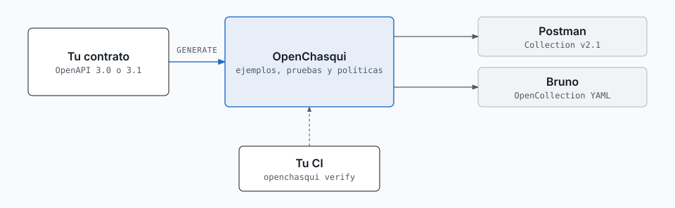
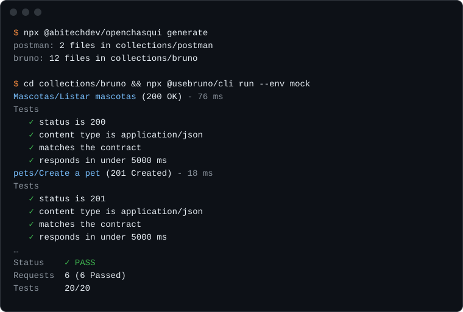

<p align="center">
  <picture>
    <source media="(prefers-color-scheme: dark)" srcset="docs/imagenes/logo-oscuro.svg">
    
  </picture>
</p>

<h1 align="center">OpenChasqui</h1>

<p align="center">Genera, valida y distribuye colecciones de API, como Postman y Bruno, desde un contrato OpenAPI</p>

<p align="center">
  <a href="https://www.npmjs.com/package/@abitechdev/openchasqui"></a>
  <a href="https://github.com/abitech-dev/abitech-openchasqui-cli/actions/workflows/ci.yml"></a>
  
  <a href="LICENSE"></a>
</p>

<p align="center">
  <a href="#inicio-rápido">Inicio rápido</a> &nbsp;|&nbsp;
  <a href="#uso">Uso</a> &nbsp;|&nbsp;
  <a href="#documentación">Documentación</a> &nbsp;|&nbsp;
  <a href="README.en.md">English</a>
</p>

<picture>
  <source media="(prefers-color-scheme: dark)" srcset="docs/diagramas/flujo-dark.svg">
  
</picture>

El _chasqui_ llevaba mensajes por la red de caminos inca. OpenChasqui lleva tu
contrato de API a cada herramienta que usa tu equipo, con entornos, ejemplos
realistas y pruebas de contrato, y la integración continua evita que se
desactualicen.

> [!NOTE]
> OpenChasqui está en desarrollo temprano (0.x). La configuración y el contrato
> de plugins pueden cambiar antes de la 1.0.

## Qué resuelve

<table>
  <tr>
    <td width="50%" valign="top">
      <picture><source media="(prefers-color-scheme: dark)" srcset="docs/iconos/fuente-dark.svg"></picture><br><strong>Una sola fuente de verdad</strong><br>Las colecciones salen del contrato y nunca se editan a mano.
    </td>
    <td width="50%" valign="top">
      <picture><source media="(prefers-color-scheme: dark)" srcset="docs/iconos/pruebas-dark.svg"></picture><br><strong>Pruebas incluidas</strong><br>Cada petición comprueba estado, tipo de contenido, esquema y tiempo de respuesta.
    </td>
  </tr>
  <tr>
    <td width="50%" valign="top">
      <picture><source media="(prefers-color-scheme: dark)" srcset="docs/iconos/herramientas-dark.svg"></picture><br><strong>Postman y Bruno</strong><br>Postman Collection v2.1 y Bruno OpenCollection en la misma corrida.
    </td>
    <td width="50%" valign="top">
      <picture><source media="(prefers-color-scheme: dark)" srcset="docs/iconos/overlays-dark.svg"></picture><br><strong>Overlays</strong><br>Renombra, reagrupa u oculta endpoints con OpenAPI Overlay 1.0, sin tocar el contrato.
    </td>
  </tr>
  <tr>
    <td width="50%" valign="top">
      <picture><source media="(prefers-color-scheme: dark)" srcset="docs/iconos/datos-dark.svg"></picture><br><strong>Datos realistas</strong><br>Ejemplos deterministas, con DNI, RUC, celulares y ubigeo peruanos cuando los pidas.
    </td>
    <td width="50%" valign="top">
      <picture><source media="(prefers-color-scheme: dark)" srcset="docs/iconos/seguridad-dark.svg"></picture><br><strong>Seguro por defecto</strong><br>Los secretos nunca llevan valor y solo se reemplazan sus propias carpetas.
    </td>
  </tr>
</table>

## Inicio rápido

```bash
npm i -D @abitechdev/openchasqui
npx openchasqui init       # crea openchasqui.config.yaml
npx openchasqui generate   # escribe collections/postman y collections/bruno
npx openchasqui verify     # en la integración continua
```

<p align="center">
  
</p>

Importa la carpeta en Postman o Bruno, o córrela con `newman` o la CLI de
Bruno. También funciona sin instalar, con `npx @abitechdev/openchasqui`.

## Uso

| Herramienta                 | `targets` | Estado        |
| --------------------------- | --------- | ------------- |
| Postman (Collection v2.1)   | `postman` | Disponible    |
| Bruno (OpenCollection YAML) | `bruno`   | Disponible    |
| Archivos `.http` e Insomnia |           | Planeado, 1.2 |
| k6 y Playwright             |           | Planeado, 2.0 |

Para generar colecciones basta el CLI. Los otros dos paquetes sirven por
separado:

| Paquete                                                     | Para qué                                             |
| ----------------------------------------------------------- | ---------------------------------------------------- |
| [`@abitechdev/openchasqui`](packages/cli)                   | El CLI, con todos los plugins incluidos              |
| [`@abitechdev/openchasqui-plugin-kit`](packages/plugin-kit) | Contrato y utilidades para escribir un plugin        |
| [`@abitechdev/openchasqui-data-es-pe`](packages/data-es-pe) | Datos de prueba peruanos: DNI, RUC, celular y ubigeo |

## Compatibilidad

| Herramienta | Versión                   |
| ----------- | ------------------------- |
| Node.js     | 22 o superior             |
| OpenAPI     | 3.0 y 3.1, en JSON o YAML |
| Overlay     | OpenAPI Overlay 1.0       |

## Documentación

| Quiero…                                                | Documento                                                       |
| ------------------------------------------------------ | --------------------------------------------------------------- |
| Ajustar la configuración, los overlays o las políticas | [referencia-configuracion.md](docs/referencia-configuracion.md) |
| Saber qué viene en cada versión                        | [hoja-de-ruta.md](docs/hoja-de-ruta.md)                         |
| Escribir un plugin                                     | [plugin-kit](packages/plugin-kit)                               |
| Saber por qué se publica así                           | [ADR 0001](docs/decisiones/0001-ramas-y-publicacion.md)         |
| Ver los cambios por versión                            | [CHANGELOG.md](packages/cli/CHANGELOG.md)                       |

## Contribuir

Los pasos y lo que revisa la integración continua están en
[CONTRIBUTING.md](CONTRIBUTING.md). Para reportar una vulnerabilidad, sigue
[SECURITY.md](SECURITY.md).

## Licencia

Copyright 2026 The OpenChasqui Authors. Licencia Apache 2.0, cuyo texto figura
en [LICENSE](LICENSE).
