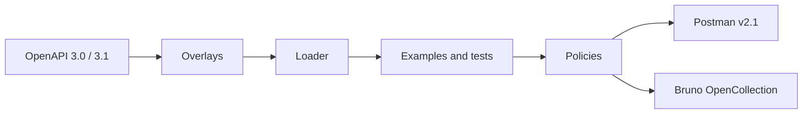

<p align="center">
  <picture>
    <source media="(prefers-color-scheme: dark)" srcset=".github/assets/logo-dark.svg">
    
  </picture>
</p>

<p align="center">
  <strong>Your OpenAPI contract, delivered as tested Postman and Bruno collections.</strong>
</p>

<p align="center">
  <a href="https://www.npmjs.com/package/@abitechdev/openchasqui"></a>
  <a href="https://github.com/abitech-dev/abitech-openchasqui-cli/actions/workflows/ci.yml"></a>
  
  
  <a href="LICENSE"></a>
</p>

<p align="center">
  <a href="#quick-start">Quick start</a> ·
  <a href="#configuration">Configuration</a> ·
  <a href="#overlays">Overlays</a> ·
  <a href="#policies">Policies</a> ·
  <a href="#packages">Packages</a> ·
  <a href="README.es.md">Español</a>
</p>

<p align="center">
  
</p>

The _chasqui_ carried messages across the Inca road network. OpenChasqui
carries your API contract to every tool your team uses: one command turns an
OpenAPI document into collections with environments, realistic examples and
contract tests, and CI keeps them from drifting.

> [!NOTE]
> OpenChasqui is in early development (0.x). The configuration and the plugin
> contract may change before 1.0.

## Features

|                                                                                                                                |                                                                                                                         |
| ------------------------------------------------------------------------------------------------------------------------------ | ----------------------------------------------------------------------------------------------------------------------- |
| **One source of truth.** Collections are generated from the contract, never edited by hand, so they cannot drift from the API. | **Tests included.** Every request checks its status, content type, response schema and response time.                   |
| **Postman and Bruno.** Postman Collection v2.1 and Bruno OpenCollection YAML from the same run.                                | **Overlays.** Rename, regroup or hide endpoints with OpenAPI Overlay 1.0, without touching the contract.                |
| **Realistic data.** Deterministic examples, with Peruvian DNI, RUC, phones and ubigeo when you want them.                      | **Safe by default.** Secrets never get a value, examples cannot carry tokens, and only its own folders are overwritten. |

## Quick start

Requires Node.js 22 or later. In the folder of your `openapi.yaml`:

```bash
npx @abitechdev/openchasqui init       # writes openchasqui.config.yaml
npx @abitechdev/openchasqui generate   # writes collections/postman and collections/bruno
npx @abitechdev/openchasqui verify     # in CI: policies pass and collections are up to date
```

Import the folder in Postman or Bruno, or run it from the command line:

```bash
npx newman run collections/postman/*.postman_collection.json   -e collections/postman/*-dev.postman_environment.json
cd collections/bruno && npx @usebruno/cli run --env dev
```

## How it works



Each step is a plugin with a versioned contract. The pipeline sorts its output
and seeds its random data by operation, so the same contract always produces
the same bytes and `verify` can compare them in CI.

## What you get

```text
collections/
├── postman/
│   ├── petstore.postman_collection.json
│   └── petstore-dev.postman_environment.json
└── bruno/
    ├── opencollection.yml
    ├── environments/dev.yml
    ├── pets/
    │   ├── folder.yml
    │   ├── List pets.yml
    │   └── Create a pet.yml
    └── store/
        └── Opening hours.yml
```

Each request carries its own tests. This is the Bruno script generated for
`GET /pets`, trimmed:

```js
test("status is 200", function () {
  expect(res.getStatus()).to.be.oneOf([200]);
});

test("matches the contract", function () {
  const Ajv = require("ajv");
  const ajv = new Ajv({ strict: false, allErrors: true });
  const valid = ajv.validate(
    {
      type: "array",
      items: {
        /* Pet */
      },
    },
    res.getBody(),
  );
  expect(valid, ajv.errorsText()).to.equal(true);
});
```

With `data: es-pe`, missing examples are filled with Peruvian test data. People
have both surnames, each object keeps one person and one place, and the RUC
carries a valid SUNAT check digit:

```json
{
  "nombre": "Carmen",
  "apellidos": "Cárdenas Vásquez",
  "correo": "carmen.cardenas@example.com",
  "dni": "47711067",
  "ruc": "20581968508",
  "celular": "942925340",
  "ubigeo": "100101",
  "distrito": "Huánuco"
}
```

## Configuration

```yaml
version: 1
source: openapi.yaml
overlays: [names.overlay.yaml]
data: es-pe
targets: [postman, bruno]
output: collections
environments:
  qa:
    variables:
      baseUrl: https://api.qa.example.com
    secrets: [token]
```

| Key            | Required | Description                                                          |
| -------------- | -------- | -------------------------------------------------------------------- |
| `version`      | yes      | Configuration version, `1`                                           |
| `source`       | yes      | OpenAPI 3.0 or 3.1 document, JSON or YAML                            |
| `targets`      | yes      | `postman`, `bruno` or both                                           |
| `output`       | yes      | Folder for the collections, one subfolder per target                 |
| `overlays`     | no       | [Overlay 1.0](https://spec.openapis.org/overlay/v1.0.html) documents |
| `data`         | no       | Synthetic examples: `generic` (default) or `es-pe`                   |
| `environments` | no       | Variables and secret names per environment                           |
| `variables`    | no       | Names for the base URL, token and API key variables                  |
| `tests`        | no       | `responseTimeMs`, the slowest acceptable response (default 5000)     |

`openchasqui` only replaces folders it created before; it refuses to write over
anything else. No environment may look like production, and a secret never
gets a value.

## Overlays

An overlay renames, regroups or trims the collection without touching the
contract. Two extensions control the layout:

```yaml
overlay: 1.0.0
info: { title: Spanish names, version: 1.0.0 }
actions:
  - target: $.paths['/banks'].get
    update:
      summary: Listar bancos
      x-openchasqui-folder: Catálogos/Bancos
      x-openchasqui-order: 1
  - target: $.paths['/internal/metrics']
    remove: true
```

## Policies

`generate` and `verify` report:

| Rule                     | Severity | When                                                |
| ------------------------ | -------- | --------------------------------------------------- |
| `no-secrets-in-examples` | error    | An example contains a JWT, a cloud key or a token   |
| `reserved-email-domains` | warning  | An example email is not on `example.com` or similar |
| `success-response`       | warning  | An operation documents no 2xx response              |
| `public-write`           | warning  | A write operation has no authentication             |

## Packages

| Package                                                                       | Purpose                                      |
| ----------------------------------------------------------------------------- | -------------------------------------------- |
| [`@abitechdev/openchasqui`](packages/cli)                                     | Command line                                 |
| [`@abitechdev/openchasqui-core`](packages/core)                               | Pipeline                                     |
| [`@abitechdev/openchasqui-spec`](packages/spec)                               | Canonical model and plugin contract          |
| [`@abitechdev/openchasqui-plugin-kit`](packages/plugin-kit)                   | Helpers for plugin authors                   |
| [`@abitechdev/openchasqui-transformer-overlay`](packages/transformer-overlay) | Overlay 1.0                                  |
| [`@abitechdev/openchasqui-loader-openapi`](packages/loader-openapi)           | OpenAPI 3.0 and 3.1 loader                   |
| [`@abitechdev/openchasqui-generator-examples`](packages/generator-examples)   | Synthetic examples                           |
| [`@abitechdev/openchasqui-generator-tests`](packages/generator-tests)         | Contract tests                               |
| [`@abitechdev/openchasqui-validator-policies`](packages/validator-policies)   | Security and quality policies                |
| [`@abitechdev/openchasqui-emitter-postman`](packages/emitter-postman)         | Postman Collection v2.1                      |
| [`@abitechdev/openchasqui-emitter-bruno`](packages/emitter-bruno)             | Bruno, OpenCollection YAML                   |
| [`@abitechdev/openchasqui-data-es-pe`](packages/data-es-pe)                   | Peruvian test data: DNI, RUC, phones, ubigeo |

## Roadmap

| Version | Scope                                                                                                                                        |
| ------- | -------------------------------------------------------------------------------------------------------------------------------------------- |
| 1.0     | Overlay 1.0, examples and contract tests, policies and coverage, Bruno (OpenCollection) and Postman, `init` and `verify`, Peruvian test data |
| 1.1     | Arazzo workflows, GitHub Action, SARIF                                                                                                       |
| 1.2     | `.http` and Insomnia, OpenAPI 3.2                                                                                                            |
| 2.0     | k6 and Playwright, stable third-party plugin contract                                                                                        |

## Contributing

Issues and pull requests are welcome. Read [CONTRIBUTING.md](CONTRIBUTING.md)
first; security reports go through [SECURITY.md](SECURITY.md).

## License

[Apache License 2.0](LICENSE). Copyright 2026 The OpenChasqui Authors.
