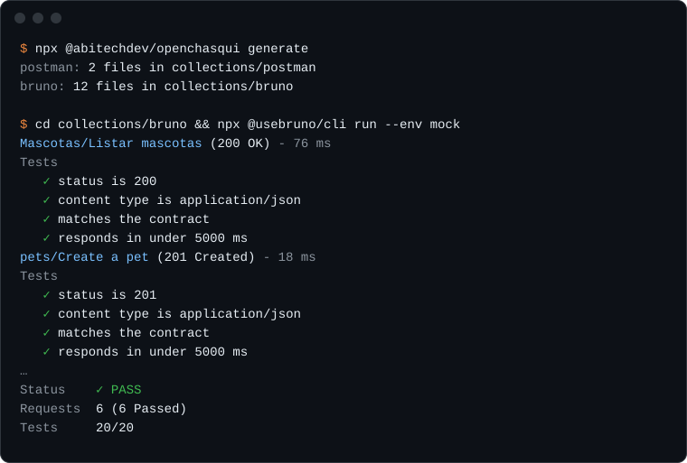
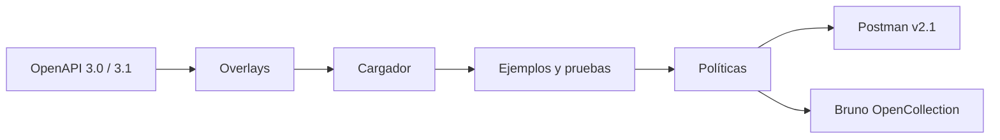

<p align="center">
  <picture>
    <source media="(prefers-color-scheme: dark)" srcset=".github/assets/logo-dark.svg">
    
  </picture>
</p>

<p align="center">
  <strong>Tu contrato OpenAPI, entregado como colecciones de Postman y Bruno con pruebas.</strong>
</p>

<p align="center">
  <a href="https://www.npmjs.com/package/@abitechdev/openchasqui"></a>
  <a href="https://github.com/abitech-dev/abitech-openchasqui-cli/actions/workflows/ci.yml"></a>
  
  
  <a href="LICENSE"></a>
</p>

<p align="center">
  <a href="#instalación">Instalación</a> ·
  <a href="#inicio-rápido">Inicio rápido</a> ·
  <a href="#configuración">Configuración</a> ·
  <a href="#overlays">Overlays</a> ·
  <a href="#políticas">Políticas</a> ·
  <a href="#paquetes">Paquetes</a> ·
  <a href="README.en.md">English</a>
</p>

<p align="center">
  
</p>

El _chasqui_ llevaba mensajes por la red de caminos inca. OpenChasqui lleva tu
contrato de API a cada herramienta que usa tu equipo: un comando convierte un
documento OpenAPI en colecciones con entornos, ejemplos realistas y pruebas de
contrato, y el CI evita que se desactualicen.

> [!NOTE]
> OpenChasqui está en desarrollo temprano (0.x). La configuración y el contrato
> de plugins pueden cambiar antes de la 1.0.

## Características

|                                                                                                                                        |                                                                                                                                           |
| -------------------------------------------------------------------------------------------------------------------------------------- | ----------------------------------------------------------------------------------------------------------------------------------------- |
| **Una sola fuente de verdad.** Las colecciones se generan desde el contrato y nunca se editan a mano, así que no se separan de la API. | **Pruebas incluidas.** Cada petición comprueba su estado, tipo de contenido, esquema de respuesta y tiempo de respuesta.                  |
| **Postman y Bruno.** Postman Collection v2.1 y Bruno OpenCollection YAML en la misma corrida.                                          | **Overlays.** Renombra, reagrupa u oculta endpoints con OpenAPI Overlay 1.0, sin tocar el contrato.                                       |
| **Datos realistas.** Ejemplos deterministas, con DNI, RUC, celulares y ubigeo peruanos cuando los pidas.                               | **Seguro por defecto.** Los secretos nunca llevan valor, los ejemplos no pueden traer tokens y solo se sobrescriben sus propias carpetas. |

## Herramientas

Elige una o varias en `targets`; `targets: [bruno]` genera solo Bruno.

| Herramienta                           | `targets` | Estado        |
| ------------------------------------- | --------- | ------------- |
| Postman (Collection v2.1)             | `postman` | Disponible    |
| Bruno (OpenCollection YAML)           | `bruno`   | Disponible    |
| Archivos `.http` (VS Code, JetBrains) |           | Planeado, 1.2 |
| Insomnia                              |           | Planeado, 1.2 |
| k6 y Playwright                       |           | Planeado, 2.0 |

Cada herramienta es un plugin emisor; sumar una no toca el núcleo.

## Instalación

Requiere Node.js 22 o superior. Instálalo como dependencia de desarrollo del
proyecto que tiene el contrato:

```bash
npm i -D @abitechdev/openchasqui
pnpm add -D @abitechdev/openchasqui
yarn add -D @abitechdev/openchasqui
```

Así el comando queda como `npx openchasqui`. También funciona sin instalar,
con `npx @abitechdev/openchasqui`.

## Inicio rápido

En la carpeta de tu `openapi.yaml`:

```bash
npx @abitechdev/openchasqui init       # crea openchasqui.config.yaml
npx @abitechdev/openchasqui generate   # escribe collections/postman y collections/bruno
npx @abitechdev/openchasqui verify     # en CI: políticas en verde y colecciones al día
```

Importa la carpeta en Postman o Bruno, o córrela desde la línea de comandos:

```bash
npx newman run collections/postman/*.postman_collection.json \
  -e collections/postman/*-dev.postman_environment.json
cd collections/bruno && npx @usebruno/cli run --env dev
```

## Cómo funciona



Cada paso es un plugin. El mismo contrato produce siempre los mismos archivos,
así que `verify` detecta en CI cualquier colección desactualizada.

## Qué obtienes

```text
collections/
├── postman/
│   ├── petstore.postman_collection.json
│   └── petstore-dev.postman_environment.json
└── bruno/
    ├── opencollection.yml
    ├── environments/dev.yml
    ├── pets/
    │   ├── folder.yml
    │   ├── List pets.yml
    │   └── Create a pet.yml
    └── store/
        └── Opening hours.yml
```

Cada petición trae sus pruebas: código de estado, tipo de contenido, esquema de
la respuesta y tiempo de respuesta.

Con `data: es-pe`, los ejemplos que faltan se llenan con datos de prueba
peruanos con la forma de una consulta a RENIEC: uno o dos nombres, los dos
apellidos, una persona y un lugar por objeto, y un RUC con dígito verificador
SUNAT válido:

```json
{
  "nombres": "Isabel Lucía",
  "apellidoPaterno": "Gutiérrez",
  "apellidoMaterno": "Castillo",
  "correo": "isabel.gutierrez@example.com",
  "dni": "11067581",
  "ruc": "20968504291",
  "celular": "925340375",
  "ubigeo": "170101",
  "distrito": "Tambopata"
}
```

## Configuración

```yaml
version: 1
source: openapi.yaml
overlays: [names.overlay.yaml]
data: es-pe
targets: [postman, bruno]
output: collections
environments:
  qa:
    variables:
      baseUrl: https://api.qa.example.com
    secrets: [token]
```

| Clave          | Obligatoria | Descripción                                                           |
| -------------- | ----------- | --------------------------------------------------------------------- |
| `version`      | sí          | Versión de la configuración, `1`                                      |
| `source`       | sí          | Documento OpenAPI 3.0 o 3.1, en JSON o YAML                           |
| `targets`      | sí          | `postman`, `bruno` o ambos                                            |
| `output`       | sí          | Carpeta de las colecciones, una subcarpeta por destino                |
| `overlays`     | no          | Documentos [Overlay 1.0](https://spec.openapis.org/overlay/v1.0.html) |
| `data`         | no          | Ejemplos sintéticos: `generic` (por defecto) o `es-pe`                |
| `environments` | no          | Variables y nombres de secretos por entorno                           |
| `variables`    | no          | Nombres de las variables de URL base, token y API key                 |
| `tests`        | no          | `responseTimeMs`, la respuesta más lenta aceptable (por defecto 5000) |

`openchasqui` solo reemplaza carpetas que él mismo creó; se niega a escribir
sobre cualquier otra. Ningún entorno puede parecer de producción y un secreto
nunca lleva valor.

## Overlays

Un overlay renombra, reagrupa o recorta la colección sin tocar el contrato. Dos
extensiones controlan la organización:

```yaml
overlay: 1.0.0
info: { title: Nombres en español, version: 1.0.0 }
actions:
  - target: $.paths['/banks'].get
    update:
      summary: Listar bancos
      x-openchasqui-folder: Catálogos/Bancos
      x-openchasqui-order: 1
  - target: $.paths['/internal/metrics']
    remove: true
```

## Políticas

`generate` y `verify` informan:

| Regla                    | Severidad   | Cuándo                                                     |
| ------------------------ | ----------- | ---------------------------------------------------------- |
| `no-secrets-in-examples` | error       | Un ejemplo contiene un JWT, una clave de nube o un token   |
| `reserved-email-domains` | advertencia | Un correo de ejemplo no usa `example.com` u otro reservado |
| `success-response`       | advertencia | Una operación no documenta ninguna respuesta 2xx           |
| `public-write`           | advertencia | Una operación de escritura no pide autenticación           |

## Paquetes

El CLI instala todo lo necesario; estos son los paquetes que lo forman.

<details>
<summary>Ver los 12 paquetes</summary>

| Paquete                                                                       | Propósito                                           |
| ----------------------------------------------------------------------------- | --------------------------------------------------- |
| [`@abitechdev/openchasqui`](packages/cli)                                     | Línea de comandos                                   |
| [`@abitechdev/openchasqui-core`](packages/core)                               | Pipeline                                            |
| [`@abitechdev/openchasqui-spec`](packages/spec)                               | Modelo canónico y contrato de plugins               |
| [`@abitechdev/openchasqui-plugin-kit`](packages/plugin-kit)                   | Utilidades para autores de plugins                  |
| [`@abitechdev/openchasqui-transformer-overlay`](packages/transformer-overlay) | Overlay 1.0                                         |
| [`@abitechdev/openchasqui-loader-openapi`](packages/loader-openapi)           | Cargador de OpenAPI 3.0 y 3.1                       |
| [`@abitechdev/openchasqui-generator-examples`](packages/generator-examples)   | Ejemplos sintéticos                                 |
| [`@abitechdev/openchasqui-generator-tests`](packages/generator-tests)         | Pruebas de contrato                                 |
| [`@abitechdev/openchasqui-validator-policies`](packages/validator-policies)   | Políticas de seguridad y calidad                    |
| [`@abitechdev/openchasqui-emitter-postman`](packages/emitter-postman)         | Postman Collection v2.1                             |
| [`@abitechdev/openchasqui-emitter-bruno`](packages/emitter-bruno)             | Bruno, OpenCollection YAML                          |
| [`@abitechdev/openchasqui-data-es-pe`](packages/data-es-pe)                   | Datos de prueba peruanos: DNI, RUC, celular, ubigeo |

</details>

## Hoja de ruta

| Versión | Alcance                                                                                                                                           |
| ------- | ------------------------------------------------------------------------------------------------------------------------------------------------- |
| 1.0     | Overlay 1.0, ejemplos y pruebas de contrato, políticas y cobertura, Bruno (OpenCollection) y Postman, `init` y `verify`, datos de prueba peruanos |
| 1.1     | Flujos Arazzo, GitHub Action, SARIF                                                                                                               |
| 1.2     | `.http` e Insomnia, OpenAPI 3.2                                                                                                                   |
| 2.0     | k6 y Playwright, contrato estable para plugins de terceros                                                                                        |

## Contribuir

Los issues y pull requests son bienvenidos. Lee primero
[CONTRIBUTING.md](CONTRIBUTING.md); los reportes de seguridad van por
[SECURITY.md](SECURITY.md).

## Licencia

[Apache License 2.0](LICENSE). Copyright 2026 The OpenChasqui Authors.
